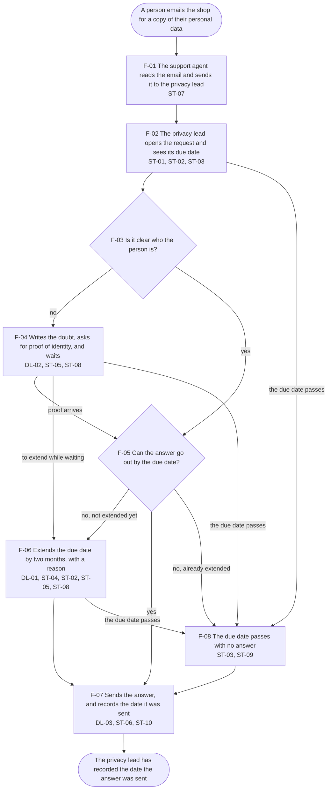

# agentic-product-spec

A set of files that hold everything a product knows that an agent cannot find in the code, and scripts that check the product against them.

- **The spec** is a folder of text files, in two levels. The product level says who the users are, the external rules, the product decisions and the business rules. The feature level says the steps of each task and what each screen shows in each situation.
- **The checks** are scripts. They check that the spec is complete, that the built screen does what the spec says, and that the screen uses the design system correctly.
- **The handoff** is a file written by a script from the spec, for anyone who builds from it: the rules, the steps of the task, the screen's states and one acceptance test per eval.

It is one source of truth for product decisions, used in every way the product is made: ideation, definition, testing and development. A decision changed once reaches every one of them, and the checks run at each step, not only at the end.

The full write-up: [One source of truth for product decisions](https://nayaramarques.com/product-spec).

## Why it exists

Every product runs on decisions: who it is for, which rules it follows, what the team chose and why, what each screen does in each situation. Each person keeps a copy: the designer in Figma, the tester in a test plan, the developer in the code, the AI tool in its prompt. When a decision changes, some copies change and some do not, and the copies drift.

AI agents make the drift faster. An agent builds from what is in its context and fills every gap with a guess: it can follow a design system to the pixel and still decide on its own when a request is overdue, or which button goes away once it is answered. The spec is the one place those decisions are written, with why, so every person and every agent works from the same ones.

## The two levels of the spec

One spec per product, in the `spec/` folder.

| Level | What it holds | Where |
|---|---|---|
| Product | What the whole product shares: the roles (kinds of user) and their persona sheets, the goals of each role, the external rules, the decisions about the whole product, the business rules with their sources, the open questions and a glossary | `spec/roles.md`, `personas/`, `goals.md`, `sources/`, `decisions.md`, `rules.md`, `questions.md`, `glossary.md` |
| Feature | What each feature does: one file per task, with each step, who acts, the screen state it lands on and the decisions made for that feature; one file per screen, with every state and a table of evals | `spec/flows/`, `spec/screens/` |

A business rule can hold beyond the screens that cite it. A product rule holds on every screen, and a feature rule on every screen of one flow, so a behaviour many screens share is written once, and a screen says only what is its own. The Level column of `rules.md` says which.

Every item has an ID: roles R-01, goals G-01, external rules PRIV-01, decisions D-01, business rules BR-01, questions Q-01, flow steps F-01, screen states ST-01, evals E-01. Code, checks and the handoff cite these IDs, so a search for an ID finds everything that uses it.

## Ways to use it

The spec is written once and used in several ways. Each one reads the same files.

| Use | What happens |
|---|---|
| Build a new feature | Write the flow first, then the states it lands on and their evals. An AI tool builds the screen from them, with the design system. |
| Change a feature | A law changes, a product decision is made, or someone finds a problem. Change the spec first: the rule, the step, the state and an eval that shows the change. Then the screen. If the spec merges first, mark the new state "Built: not yet"; the checks skip it until the screen is built. A decision that changes moves to `decisions-replaced.md`, with what we learned, and the spec check names everything that still cites it. |
| Start from what you have | For a product that already exists: write the flow of one task as the product does it today, from the code and the screens. A person confirms which of those behaviours were chosen on purpose; those become decisions, and the ones nobody can explain become questions. Then the next task. |
| QA | Run the evals against the built screen (`npm run behaviour`). Each failure names the eval and what differs from the spec. |
| Review before merging | Before a change merges into the spec, a synthetic user reads the feature as each role, against the external rules and the persona sheets, three times; the findings two runs agree on are kept (`reviews/README.md`). The reviews stop when the agreed findings are only edge cases that product or feature rules already answer. |
| Keep the external rules current | Optional, for products whose external rules change often, such as regulated ones. The rules watch (`.claude/agents/rules-watch.md`) reads the sources on a schedule and lists everything that depends on a rule that changed. It belongs to the spec: a synthetic user reads the rules from here. |
| Keep the design in step | Optional, for teams whose design file changes faster than the spec. Whoever changes a screen logs from, to and why in `design/log.md`, each frame is titled with the state it draws, and `npm run design` lists what the spec does not have yet. A round of design changes ends with a pull request to the spec the same day (`.claude/agents/design-sync.md`). See "Keep the design in step" below. |
| Hand it to the backend | `npm run handoff` writes the rules, the flow and one acceptance test per eval, for whoever builds the backend. |
| Give an agent one feature | `npm run context answer-a-request` prints the rules that hold on every screen of that feature first, then its flow and screens, and only the other rules, decisions, questions and persona sheets they touch. The agent reads that, not the whole spec. |
| Answer a question | Search for an ID, such as BR-02, to find every flow, state, eval and line of code that uses it. |

## The example in this kit

The files in `spec/` describe a made-up product, so the kit has something real to check. Replace them with your own.

The product is an inbox where a shop's privacy lead answers people's requests for a copy of their personal data, under the GDPR. The legal time to answer is one month, and it can be extended once by two months. The synthetic user in [grounded-synthetic-user](https://github.com/nayyymarques-eng/grounded-synthetic-user) reviews this same spec.

- **Eight business rules**, `spec/rules.md`: one product rule (BR-06, answering is free, on every screen), one feature rule (BR-01, how the due date is counted, on every screen of answer-a-request), and six that hold only on the screens they name.
- **One flow**, `spec/flows/answer-a-request.md`: it starts when a person emails the shop, and ends when the privacy lead has recorded the answer. 8 steps, 5 evals for what no screen shows, the decisions made for this feature, and what it leaves out.
- **One screen**, `spec/screens/request.md`: one request, as the privacy lead or the support agent sees it. 10 states, 3 dialogs that open over them, and 51 evals, with one eval for every pair of states that can be true at once.

The flow, as the handoff draws it:



## What the checks found when the screen was broken

Each break below was made on purpose, one at a time. Each line is what the check printed: the check's ID, the eval, and what differed from the spec.

| What was broken | What the check printed |
|---|---|
| An overdue request still offers Extend | `BEH-07 E-03 (actions "Mark as answered, Extend", the spec says "Mark as answered")` |
| The extension is three months instead of two | `BEH-07 E-04 (due date 2027-03-03, the spec says 2027-02-03)` |
| The badge says "Late" instead of "Overdue" | `BEH-03 E-03 (status critical "Late by 1 day", the spec says critical "Overdue by 1 day")` |
| An overdue request waiting for proof can no longer record that the proof arrived | `BEH-07 E-12 (actions "Mark as answered", the spec says "Proof received, Mark as answered")` |
| A fee appears on the screen | `BEH-06 E-01 (shows "€")` |
| The Extend dialog stays open after the due date has passed | `BEH-07 E-19 (dialog DL-01, the spec says none)` |
| Extend can be used before the reason is written | `BEH-05 E-07 ("Extend" is primary, the spec says primary, disabled)` |
| The code has a state the spec does not have | `BEH-08 code (the code has ST-14, which the spec does not)` |
| A rule a state applies is named nowhere in the code | `BEH-09 code (BR-06 is applied by a state, and named nowhere in src/request.ts or screens/request.tsx)` |
| A rule cites a decision that was replaced | `SPEC-11 (BR-02 cites D-03, which was replaced by D-09)` |
| An open question reaches a second flow | `SPEC-12 (Q-01 reaches beyond one feature (answer-a-request, close-a-request, request); answer it, as a decision, before this merges)` |
| A rule has no eval | `SPEC-13 (BR-09 has no eval; add an eval on a state that applies it, or a flow eval)` |
| A rule cites a decision that does not exist | `SPEC-02 (BR-07 cites D-11, which does not exist)` |
| A feature rule names a flow that does not exist | `SPEC-02 (BR-01 is a feature rule of "close-a-request", which is not a flow)` |
| No state applies a rule | `SPEC-03 (BR-08 is applied by no state or dialog of request)` |
| A state uses a badge the design system does not have | `SPEC-05 (ST-06: badge "success" is not a badge variant)` |
| A state has no eval | `SPEC-06 (ST-04 has no eval)` |
| A step of the flow was removed | `SPEC-09 (ST-05 is reached by no step of a flow)` |
| No step opens a dialog | `SPEC-09 (DL-02 is opened by no step of a flow)` |
| A dialog has no eval where it closes | `SPEC-06 (DL-02 has no eval where it closes, on a state it does not open over)` |
| A dialog opens over a state that has no button for it | `SPEC-15 (DL-02 opens from "Ask for proof of identity", which ST-03 does not offer)` |
| A decision is still proposed | `SPEC-16 (D-01 is proposed: it merges once the person in Decided by (Product designer, with the privacy lead) sets its Status to decided)` |
| A step goes to a step that does not exist | `SPEC-08 (F-02 goes to F-09, which is not a step)` |
| A state's row in the decision table was deleted | `SPEC-17 (ST-04 has no row in the decision table)` |
| Overdue was moved above Overdue, waiting for proof | `SPEC-17 (ST-09 never wins: a row above it always matches first)` |
| Waiting for proof was written for the wrong due date | `SPEC-17 (no state for: Viewer lead, Answered no, Due date more than 7 days, Proof waiting, Extended no)` |
| "Due soon" was written to leave out the due date itself | `SPEC-17 (E-13 sets no value of Due date; its facts must set exactly one)` |
| After an extension, the step to the overdue request was left out of Next | `SPEC-18 (F-06 lands on ST-05; as days pass it becomes ST-09 (Due date passed), and neither F-06 nor a step in its Next lands on ST-09)` |
| Two states match, and the evals that say which wins were deleted | `SPEC-17 (ST-09 and ST-03 both match, and no eval says which wins; e.g. Viewer lead, Answered no, Due date passed, Proof waiting, Extended no)` |

The spec check also found a real gap in the design system: the spec needs disabled buttons in its three dialogs, and the design system's button has no disabled state. This does not block the build. It is reported for the design system's owner to decide:

```
SPEC-07 DL-01 ("Extend" is disabled; the button contract has no disabled state)
SPEC-07 DL-02 ("Ask" is disabled; the button contract has no disabled state)
SPEC-07 DL-03 ("Mark as answered" is disabled; the button contract has no disabled state)
```

## The files

| File | What it is |
|---|---|
| `spec/` | The spec. `spec/README.md` says how to write each file |
| `spec/personas/` | One persona sheet per role, with made-up data |
| `src/request.ts` | The behaviour of the example screen in code: how the due date is counted, which state applies, which buttons show. Each part cites the rule IDs it applies |
| `screens/request.tsx` | The example screen, built with [ai-ready-design-system](https://github.com/nayyymarques-eng/ai-ready-design-system). It also tells the checks how to read an eval row (`fromExample`) and how to fill the spec's {words} (`words`), so the checks work for any screen |
| `harness/spec-check.mjs` | The spec check: SPEC-01 to SPEC-18 |
| `harness/behaviour.mjs` | The behaviour check: BEH-01 to BEH-09 |
| `harness/context.mjs` | `npm run context`: one feature's part of the spec, for an agent |
| `.claude/agents/rules-watch.md` | The rules watch, run on a schedule |
| `harness/design-check.mjs` | Optional. `npm run design`: checks the design log and the design file's frame titles against the spec, DESIGN-01 to DESIGN-06 |
| `design/log.md` | The design log: each design change, from what to what, why, and the decision that brought it into the spec |
| `design/frames.json` | The frame titles of the example's design file, as a team would export them from its design tool |
| `.claude/agents/design-sync.md` | Optional. Brings a round of design changes into the spec the same day |
| `templates/.github/workflows/spec.yml` | A workflow with one job, `spec`, that runs the spec check. Copy it into your project to make `spec` a required check |
| `.github/CODEOWNERS` | Who approves a change to each part of the spec. The lines are examples, commented out |
| `harness/look.mjs` | Runs the design system's checks on every state |
| `harness/handoff.mjs` | Writes `handoff/` from the spec |
| `handoff/request.md` | The handoff for the example screen, written by the script |
| `reviews/` | How to run a synthetic user on the spec |
| `AGENTS.md` | What an AI tool reads, and in what order, before it builds, changes or reviews a screen |

## How to use it

Once: `npm install`, then `npx playwright install chromium`.

1. Write the spec in `spec/`, as `spec/README.md` says. Start with the flow of one task.
2. Run `npm run spec` until it passes.
3. Use it in any of the ways above. An AI tool reads `AGENTS.md` first.
4. Run `npm run check` on every pull request. `.github/workflows/checks.yml` does it for you.
5. To block a merge when the spec fails, copy `templates/.github/workflows/spec.yml` into your project's `.github/workflows/`, and set the path to the spec check in its last line. Push it once, so the `spec` check appears on a pull request. Only then mark `spec` as a required status check in the main branch ruleset. A required check that no workflow reports never passes, and nothing can merge.

The smallest start: one flow, the screen it lands on, and five evals.

## Keep the design in step

Optional. The spec leads and the design follows: a screen is built from the spec. But the spec is still being shaped, and much of that shaping happens in the design file. When the spec lags, whoever builds the screen finds the difference later, by accident, and nobody remembers why it changed. The rule is simple: **when the design changes, the spec changes the same day, with its why.** Each team plugs in its own design tool.

1. **Log each change as you make it.** Whoever changes a screen writes one row in `design/log.md`: the frame, what it was, what it is now, and why. It takes a minute, and it keeps the why, which nobody can read back from a drawing. This is the main step.
2. **Title every frame by what it draws**: `<screen> · ST-03` for a state of the spec (`<screen> · ST-03, DL-01` for a dialog over it), `Explore · …` for an option nobody has picked, `Reference · …` for an explanation. Export the titles to `design/frames.json`, a list of `{ "title": "…", "page": "…" }`, with the team's own script, plugin or copy by hand.
3. **Run `npm run design`.** It lists the logged changes not in the spec yet. It fails on a log row with no from, to or why (DESIGN-05), or that cites a decision the spec does not have (DESIGN-06); on a frame that names no state (DESIGN-01), a screen the spec does not have (DESIGN-02), or a state or dialog that screen does not have (DESIGN-03). It notes the states no frame draws (DESIGN-04), without failing.
4. **Close the round the same day.** Someone owns it: for each logged change they write the decision (`proposed`, with the logged why), the state and its eval, and open the spec pull request. `.claude/agents/design-sync.md` does this with an agent.
5. **Optional, the drawing review, a safety net for what nobody logged.** The export also saves an image of each changed frame (an `image` field in `frames.json`). The agent looks at each image beside its state in the spec and lists what differs: words, buttons, which is primary, the dialog it opens. It runs three times and keeps what at least two passes found; the rest goes on a list to check by eye.

What the script does not check: that a drawing matches its state. The log says what changed; the drawing review looks for what nobody wrote down, but it is a model reading a still image: a review, not a check. It sees no colour, type, motion or interaction, nothing the spec does not state, and never the why. A person still looks at the frames in the pull request.

It came from a real case. In a product that uses this kit, the design file got about six hours ahead of the spec during one evening of design notes: about ten decisions lived only in the design. Nobody owned the moment a change goes back to the spec, so the rule became "a round of design notes ends with a spec pull request the same day". Even then, the person coding found two differences the titles could not show, a carousel and a typeface.

We then tried the drawing review on 12 of those boards, against the spec from before the fix, three times. Every pass found the four changes we knew about: the carousel and three screens the spec did not have. Every pass also found a difference nobody had seen, a missing button, and none reported a difference that was not there. No pass saw the typeface, which the spec never stated, and one real difference showed up in only one pass. That is why the log comes first, and the review is the net.

## What each team can change

| Part | What a team chooses | What stays the same |
|---|---|---|
| The spec's files | Which files it keeps, and their names | Every rule, goal, decision, step and state has an ID, and everything that uses it cites the ID |
| Sources | Laws, regulator guidance, contracts, policies | A rule with no source is a question, not a rule |
| Decisions | Who may decide, and how much of the why to write | A decision about the whole product goes in the product decision log; every decision made for a feature goes in that feature's decision log. Each says why, who, when and what it applies to |
| Persona sheets | How many interviews make a trait strong | Each trait cites its source; what nobody said is a hypothesis |
| Flows | How many, and how detailed | Every step lands on a state, and every state is reached by a step |
| States | How many, which one wins when two apply, and whether a decision table says when each applies | Every state has at least one eval, and the evals are the tests |
| The design system | Any design system that has written contracts, such as [ai-ready-design-system](https://github.com/nayyymarques-eng/ai-ready-design-system) ([the framework](https://nayaramarques.com/design-system)). Set its folder in `package.json`, under `productSpec.designSystem` | The spec names only components, variants and templates the design system has |
| The design file | Its tool, how its frame titles are exported, where the log line is written first, and whether every state gets a frame | Every frame names a state of the spec, or says it is an option or an explanation. Every design change is logged with its why, and reaches the spec the same day |
| The handoff | Its sections and where it goes | It is written from the spec, never by hand |

## Limits

- The spec is only as right as the people who write and approve it. The checks find what is missing or inconsistent, not a wrong rule.
- A rule ID in the code makes the rule findable; only the evals show the code applies it.
- Copies kept outside the repository, such as a design file or a test plan, still drift. A decision changed in the spec reaches what works from the spec. The design log keeps each design change and its why until it reaches the spec; the design check catches a frame the spec does not have; the drawing review looks for a drawing that differs from its state, as a review, not a check.
- The evals are tests of the situations someone wrote down. A situation nobody wrote down is not checked. Flow evals are listed for the backend's tests; this kit does not run them.
- The spec review is an AI model reading the spec. Three runs reduce what one run misses or invents; they do not remove it.
- The behaviour check looks at the screen once per eval, as a still screen. It does not click through the flow, or test timing, focus or the keyboard.
- It does not test usability or say what to build.
- It was built on one flow and one screen of a made-up product, by one person working alone. It has not been tried on a large product or by a team: who may change which part of the spec, who approves each change, and how two people working on the same decision agree are still open.
- It works the same for a new product and an existing one: it needs the decisions, rules and behaviour written down either way. How to recover them from an existing product is not covered.
- The external rules in `spec/sources/` are marked "to confirm": nobody has read the GDPR text for this example. The persona sheets are made up.

## License

MIT
