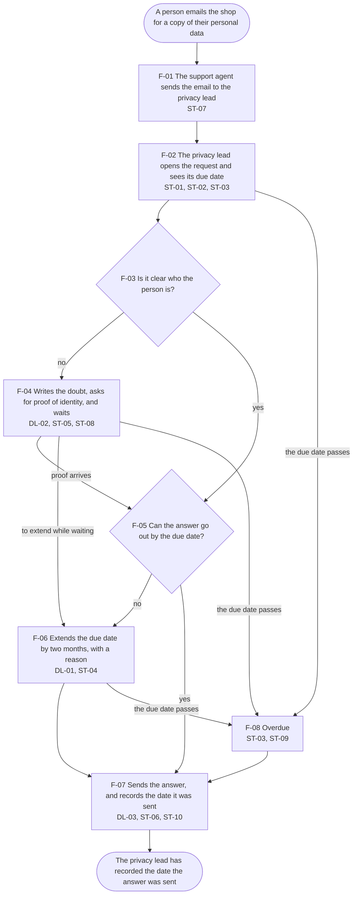

# agentic-product-spec

A set of files that hold everything a product knows that an agent cannot find in the code, and scripts that check the product against them.

- **The spec** is a folder of text files, in two levels. The product level says who the users are, the external rules, the product decisions and the business rules. The feature level says the steps of each task and what each screen shows in each situation.
- **The checks** are scripts. They check that the spec is complete, that the built screen does what the spec says, and that the screen uses the design system correctly.
- **The handoff** is a file written by a script from the spec, for anyone who builds from it: the rules, the steps of the task, the screen's states and one acceptance test per eval.

It is one source of truth for product decisions, used in every way the product is made: ideation, definition, testing and development. A decision changed once reaches every one of them, and the checks run at each step, not only at the end.

The full write-up: [One source of truth for product decisions](https://nayaramarques.com/product-spec).

## Why it exists

Every product runs on decisions: who it is for, which rules it follows, what the team chose and why, what each screen does in each situation. Each person keeps a copy: the designer in Figma, the tester in a test plan, the developer in the code, the AI tool in its prompt. When a decision changes, some copies change and some do not, and the copies drift.

AI agents make the drift faster. An agent builds from what is in its context and fills every gap with a guess: it can follow a design system to the pixel and still decide on its own when a request is overdue, or which button goes away once it is answered. The spec is the one place those decisions are written, with why, so every person and every agent works from the same ones.

## The two levels of the spec

One spec per product, in the `spec/` folder.

| Level | What it holds | Where |
|---|---|---|
| Product | What the whole product shares: the roles (kinds of user) and their persona sheets, the goals of each role, the external rules, the decisions that reach beyond one feature, the business rules with their sources, the open questions and a glossary | `spec/roles.md`, `personas/`, `goals.md`, `sources/`, `decisions.md`, `rules.md`, `questions.md`, `glossary.md` |
| Feature | What each feature does: one file per task, with each step, who acts, the screen state it lands on and the decisions for that feature only; one file per screen, with every state and a table of evals | `spec/flows/`, `spec/screens/` |

Every item has an ID: roles R-01, goals G-01, external rules PRIV-01, decisions D-01, business rules BR-01, questions Q-01, flow steps F-01, screen states ST-01, evals E-01. Code, checks and the handoff cite these IDs, so a search for an ID finds everything that uses it.

## Ways to use it

The spec is written once and used in several ways. Each one reads the same files.

| Use | What happens |
|---|---|
| Build a new feature | Write the flow first, then the states it lands on and their evals. An AI tool builds the screen from them, with the design system. |
| Change a feature | A law changes, a product decision is made, or someone finds a problem. Change the spec first: the rule, the step, the state and an eval that shows the change. Then the screen. If the spec merges first, mark the new state "Built: not yet"; the checks skip it until the screen is built. A decision that changes moves to `decisions-replaced.md`, and the spec check names everything that still cites it. |
| Start from what you have | For a product that already exists: write the flow of one task as the product does it today, from the code and the screens. A person confirms which of those behaviours were chosen on purpose; those become decisions, and the ones nobody can explain become questions. Then the next task. |
| QA | Run the evals against the built screen (`npm run behaviour`). Each failure names the eval and what differs from the spec. |
| Review before merging | Before a change merges into the spec, a synthetic user reads the feature as each role, against the external rules and the persona sheets, three times; the findings two runs agree on are kept (`reviews/README.md`). |
| Keep the external rules current | Optional, for products whose external rules change often, such as regulated ones. The rules watch (`.claude/agents/rules-watch.md`) reads the sources on a schedule and lists everything that depends on a rule that changed. It belongs to the spec: a synthetic user reads the rules from here. |
| Hand it to the backend | `npm run handoff` writes the rules, the flow and one acceptance test per eval, for whoever builds the backend. |
| Give an agent one feature | `npm run context answer-a-request` prints that feature's flow and screens, and only the rules, decisions, questions and persona sheets they touch. The agent reads that, not the whole spec. |
| Answer a question | Search for an ID, such as BR-02, to find every flow, state, eval and line of code that uses it. |

## The example in this kit

The files in `spec/` describe a made-up product, so the kit has something real to check. Replace them with your own.

The product is an inbox where a shop's privacy lead answers people's requests for a copy of their personal data, under the GDPR. The legal time to answer is one month, and it can be extended once by two months. The synthetic user in [grounded-synthetic-user](https://github.com/nayyymarques-eng/grounded-synthetic-user) reviews this same spec.

- **One flow**, `spec/flows/answer-a-request.md`: it starts when a person emails the shop, and ends when the privacy lead has recorded the answer. 8 steps, 5 evals for what no screen shows, the decisions only this feature needs, and what it leaves out.
- **One screen**, `spec/screens/request.md`: one request, as the privacy lead or the support agent sees it. 10 states, 3 dialogs that open over them, and 51 evals, with one eval for every pair of states that can be true at once.

The flow, as the handoff draws it:



## What the checks found when the screen was broken

Each break below was made on purpose, one at a time. Each line is what the check printed: the check's ID, the eval, and what differed from the spec.

| What was broken | What the check printed |
|---|---|
| An overdue request still offers Extend | `BEH-07 E-03 (actions "Mark as answered, Extend", the spec says "Mark as answered")` |
| The extension is three months instead of two | `BEH-07 E-04 (due date 2027-03-03, the spec says 2027-02-03)` |
| The badge says "Late" instead of "Overdue" | `BEH-03 E-03 (status critical "Late by 1 day", the spec says critical "Overdue by 1 day")` |
| An overdue request waiting for proof can no longer record that the proof arrived | `BEH-07 E-12 (actions "Mark as answered", the spec says "Proof received, Mark as answered")` |
| A fee appears on the screen | `BEH-06 E-01 (shows "€")` |
| The Extend dialog stays open after the due date has passed | `BEH-07 E-19 (dialog DL-01, the spec says none)` |
| Extend can be used before the reason is written | `BEH-05 E-07 ("Extend" is primary, the spec says primary, disabled)` |
| The code has a state the spec does not have | `BEH-08 code (the code has ST-14, which the spec does not)` |
| A rule a state applies is named nowhere in the code | `BEH-09 code (BR-06 is applied by a state, and named nowhere in src/request.ts or screens/request.tsx)` |
| A rule cites a decision that was replaced | `SPEC-11 (BR-02 cites D-03, which was replaced by D-09)` |
| An open question reaches a second flow | `SPEC-12 (Q-01 reaches beyond one feature (answer-a-request, close-a-request); answer it, as a decision, before this merges)` |
| A rule has no eval | `SPEC-13 (BR-09 has no eval; add an eval on a state that applies it, or a flow eval)` |
| A rule cites a decision that does not exist | `SPEC-02 (BR-07 cites D-10, which does not exist)` |
| No state applies a rule | `SPEC-03 (BR-08 is applied by no state of request)` |
| A state uses a badge the design system does not have | `SPEC-05 (ST-06: badge "success" is not a badge variant)` |
| A state has no eval | `SPEC-06 (ST-04 has no eval)` |
| A step of the flow was removed | `SPEC-09 (ST-05 is reached by no step of a flow)` |
| No step opens a dialog | `SPEC-09 (DL-02 is opened by no step of a flow)` |
| A dialog has no eval where it closes | `SPEC-06 (DL-02 has no eval where it closes, on a state it does not open over)` |
| A dialog opens over a state that has no button for it | `SPEC-15 (DL-02 opens from "Ask for proof of identity", which ST-03 does not offer)` |
| A step goes to a step that does not exist | `SPEC-08 (F-02 goes to F-09, which is not a step)` |

The spec check also found a real gap in the design system: the spec needs disabled buttons in its three dialogs, and the design system's button has no disabled state. This does not block the build. It is reported for the design system's owner to decide:

```
SPEC-07 DL-01 ("Extend" is disabled; the button contract has no disabled state)
SPEC-07 DL-02 ("Ask" is disabled; the button contract has no disabled state)
SPEC-07 DL-03 ("Mark as answered" is disabled; the button contract has no disabled state)
```

## The files

| File | What it is |
|---|---|
| `spec/` | The spec. `spec/README.md` says how to write each file |
| `spec/personas/` | One persona sheet per role, with made-up data |
| `src/request.ts` | The behaviour of the example screen in code: how the due date is counted, which state applies, which buttons show. Each part cites the rule IDs it applies |
| `screens/request.tsx` | The example screen, built with [ai-ready-design-system](https://github.com/nayyymarques-eng/ai-ready-design-system). It also tells the checks how to read an eval row (`fromExample`) and how to fill the spec's {words} (`words`), so the checks work for any screen |
| `harness/spec-check.mjs` | The spec check: SPEC-01 to SPEC-15 |
| `harness/behaviour.mjs` | The behaviour check: BEH-01 to BEH-09 |
| `harness/context.mjs` | `npm run context`: one feature's part of the spec, for an agent |
| `.claude/agents/rules-watch.md` | The rules watch, run on a schedule |
| `.github/CODEOWNERS` | Who approves a change to each part of the spec. The lines are examples, commented out |
| `harness/look.mjs` | Runs the design system's checks on every state |
| `harness/handoff.mjs` | Writes `handoff/` from the spec |
| `handoff/request.md` | The handoff for the example screen, written by the script |
| `reviews/` | How to run a synthetic user on the spec |
| `AGENTS.md` | What an AI tool reads, and in what order, before it builds, changes or reviews a screen |

## How to use it

Once: `npm install`, then `npx playwright install chromium`.

1. Write the spec in `spec/`, as `spec/README.md` says. Start with the flow of one task.
2. Run `npm run spec` until it passes.
3. Use it in any of the ways above. An AI tool reads `AGENTS.md` first.
4. Run `npm run check` on every pull request. `.github/workflows/checks.yml` does it for you.

The smallest start: one flow, the screen it lands on, and five evals.

## What each team can change

| Part | What a team chooses | What stays the same |
|---|---|---|
| The spec's files | Which files it keeps, and their names | Every rule, goal, decision, step and state has an ID, and everything that uses it cites the ID |
| Sources | Laws, regulator guidance, contracts, policies | A rule with no source is a question, not a rule |
| Decisions | Who may decide, and how much of the why to write | One log for the product; each decision says why, who, when and what it applies to |
| Persona sheets | How many interviews make a trait strong | Each trait cites its source; what nobody said is a hypothesis |
| Flows | How many, and how detailed | Every step lands on a state, and every state is reached by a step |
| States | How many, and which one wins when two apply | Every state has at least one eval, and the evals are the tests |
| The design system | Any design system that has written contracts, such as [ai-ready-design-system](https://github.com/nayyymarques-eng/ai-ready-design-system) ([the framework](https://nayaramarques.com/design-system)). Set its folder in `package.json`, under `productSpec.designSystem` | The spec names only components, variants and templates the design system has |
| The handoff | Its sections and where it goes | It is written from the spec, never by hand |

## Limits

- The spec is only as right as the people who write and approve it. The checks find what is missing or inconsistent, not a wrong rule.
- A rule ID in the code makes the rule findable; only the evals show the code applies it.
- Copies kept outside the repository, such as a design file or a test plan, still drift. A decision changed in the spec reaches what works from the spec.
- The evals are tests of the situations someone wrote down. A situation nobody wrote down is not checked. Flow evals are listed for the backend's tests; this kit does not run them.
- The spec review is an AI model reading the spec. Three runs reduce what one run misses or invents; they do not remove it.
- The behaviour check looks at the screen once per eval, as a still screen. It does not click through the flow, or test timing, focus or the keyboard.
- It does not test usability or say what to build.
- It was built on one flow and one screen of a made-up product. It has not been tried on a large product or by a team.
- The external rules in `spec/sources/` are marked "to confirm": nobody has read the GDPR text for this example. The persona sheets are made up.

## License

MIT
