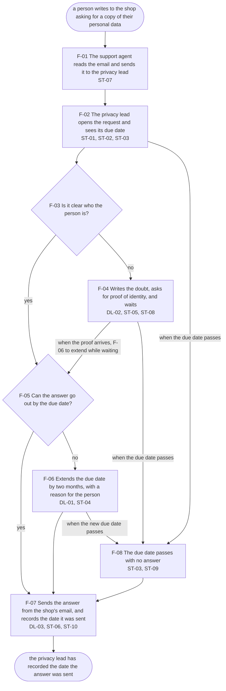

# Handoff: Request

Written by `npm run handoff` from `spec/screens/request.md` and the files it cites. Do not edit it: change the spec and run it again.

## The screen

- Template: detail-page (ai-ready-design-system, `contracts/detail-page.md`)
- Used by: Privacy lead (R-01), Support agent (R-02)
- Goals: Answer every request within the legal time (G-01); See first what needs action (G-02); Show later what was done, by whom and when (G-03); Hand a request on, and know it reached the privacy lead (G-04)
- Never shows: €, fee, price

## Flow: Answer a request

From `spec/flows/answer-a-request.md`. Starts when a person writes to the shop asking for a copy of their personal data. Each box names the states of this screen it lands on.

## Rules

Each rule is a requirement. Its sources say why, so a change upstream finds this screen.

| ID | Rule | Sources |
|---|---|---|
| BR-01 | The due date is one month after the day the request reached the shop, not the day the support agent sent it on or the day the privacy lead opened it. | PRIV-01, Q-02, Q-03 |
| BR-02 | The privacy lead can extend the due date once, before it passes, by two more months, and only after writing the reason that goes into the letter to the person. | PRIV-02, PRIV-03, D-04, D-07, D-09, Q-04 |
| BR-03 | A request past its due date and not answered is overdue, and says so until someone closes it. An answer after the due date says how late it was. | PRIV-01, D-02, D-08 |
| BR-04 | The privacy lead marks a request as answered with the date the answer was sent: not after today, and not before the request reached the shop. The product sends nothing to the person. | PRIV-04, D-01, D-09, Q-05 |
| BR-05 | The privacy lead asks for proof of identity only with a reasonable doubt, written down. The due date does not move while the lead waits. | PRIV-07, D-05, D-09, Q-01 |
| BR-06 | Answering is free, and the product never charges for a copy. No screen shows a fee or a price. | PRIV-06, PRIV-08 |
| BR-07 | A request is due soon from 7 days before its due date. | D-06, G-02 |
| BR-08 | A support agent sees who has the request and the day they sent it, and nothing they can change. | R-02 |

## States

When two states could apply, the first one wins.

| ID | State | When | Status | Actions |
|---|---|---|---|---|
| ST-07 | Support agent's view | a support agent opens a request, whatever its state | none: "With the privacy lead" | none |
| ST-10 | Answered late | the privacy lead marked the request as answered, with a date after the due date | warning: "Answered {late} late" | none |
| ST-06 | Answered | the privacy lead marked the request as answered, with a date on or before the due date | positive: "Answered on {answered}" | none |
| ST-09 | Overdue, waiting for proof of identity | not answered, today is after the due date, and the proof of identity asked for has not arrived | critical: "Overdue by {overdue}" | Proof received (primary), Mark as answered (tertiary) |
| ST-03 | Overdue | not answered, and today is after the due date | critical: "Overdue by {overdue}" | Mark as answered (primary) |
| ST-08 | Waiting for proof of identity, due soon | the proof of identity asked for has not arrived, and the due date is 7 days away or less | warning: "Due {in}" | Proof received (primary), Extend (secondary) unless already extended, Mark as answered (tertiary) |
| ST-05 | Waiting for proof of identity | the proof of identity asked for has not arrived | none: "Waiting for proof of identity" | Proof received (primary), Extend (secondary) unless already extended, Mark as answered (tertiary) |
| ST-02 | Due soon | not answered, and the due date is 7 days away or less | warning: "Due {in}" | Mark as answered (primary), Extend (secondary) unless already extended, Ask for proof of identity (tertiary) |
| ST-04 | Extended | the privacy lead extended the due date, and it is more than 7 days away | info: "Extended to {due}" | Mark as answered (primary), Ask for proof of identity (tertiary) |
| ST-01 | Open | none of the above | info: "Due on {due}" | Mark as answered (primary), Extend (secondary), Ask for proof of identity (tertiary) |

## Dialogs

A dialog opens over a state, which keeps its status and banner. It shows only over the states it lists, and closes when the request moves to another.

| ID | Dialog | Opens from | Over | Asks | Actions | Closes when |
|---|---|---|---|---|---|---|
| DL-01 | Extend the due date by two months | Extend | ST-01, ST-02, ST-05, ST-08 | Reason, for the letter to the person | Extend (primary, disabled until written), Cancel (tertiary) | the due date passes. Nothing is extended. |
| DL-02 | Ask for proof of identity | Ask for proof of identity | ST-01, ST-02, ST-04 | Your doubt about who wrote | Ask (primary, disabled until written), Cancel (tertiary) | the due date passes. Nothing is asked. |
| DL-03 | Mark as answered | Mark as answered | ST-01, ST-02, ST-03, ST-04, ST-05, ST-08, ST-09 | Date the answer was sent | Mark as answered (primary, disabled until written), Cancel (tertiary) | the request is answered in the meantime, by someone else or in another tab. While it is not answered, answering is always possible. |

## Acceptance tests

One per eval in the spec. `npm run behaviour` runs the screen's evals against the built screen.

- **E-01.** Given a request received 3 Nov 2026, sent on 3 Nov 2026, opened by the privacy lead on 10 Nov 2026. Then the due date is 3 Dec 2026, the screen is in ST-01 Open, and it offers Mark as answered, Extend, Ask for proof of identity. Rests on external rules still to confirm: PRIV-01, PRIV-02, PRIV-03, PRIV-06, PRIV-07, PRIV-08.
- **E-02.** Given a request received 3 Nov 2026, sent on 3 Nov 2026, opened by the privacy lead on 28 Nov 2026. Then the due date is 3 Dec 2026, the screen is in ST-02 Due soon, and it offers Mark as answered, Extend, Ask for proof of identity. Rests on external rules still to confirm: PRIV-01, PRIV-02, PRIV-03, PRIV-07.
- **E-03.** Given a request received 3 Nov 2026, sent on 3 Nov 2026, opened by the privacy lead on 4 Dec 2026. Then the due date is 3 Dec 2026, the screen is in ST-03 Overdue, and it offers Mark as answered. Rests on external rules still to confirm: PRIV-01, PRIV-02, PRIV-03.
- **E-04.** Given a request received 3 Nov 2026, sent on 3 Nov 2026, extended on 20 Nov 2026, opened by the privacy lead on 25 Nov 2026. Then the due date is 3 Feb 2027, the screen is in ST-04 Extended, and it offers Mark as answered, Ask for proof of identity. Rests on external rules still to confirm: PRIV-02, PRIV-03.
- **E-05.** Given a request received 3 Nov 2026, sent on 3 Nov 2026, proof asked on 12 Nov 2026, opened by the privacy lead on 20 Nov 2026. Then the due date is 3 Dec 2026, the screen is in ST-05 Waiting for proof of identity, and it offers Proof received, Extend, Mark as answered. Rests on external rules still to confirm: PRIV-01, PRIV-02, PRIV-03, PRIV-07.
- **E-06.** Given a request received 3 Nov 2026, sent on 3 Nov 2026, answered on 28 Nov 2026, opened by the privacy lead on 10 Dec 2026. Then the due date is 3 Dec 2026, the screen is in ST-06 Answered, and it offers no action. Rests on external rules still to confirm: PRIV-04.
- **E-07.** Given a request received 3 Nov 2026, sent on 3 Nov 2026, opened by the privacy lead on 20 Nov 2026, with the DL-01 Extend dialog opened and nothing written in it yet. Then the due date is 3 Dec 2026, the screen is in ST-01 Open, the DL-01 dialog shows over it, and it offers Extend, Cancel. Rests on external rules still to confirm: PRIV-01, PRIV-02, PRIV-03, PRIV-06, PRIV-07, PRIV-08.
- **E-08.** Given a request received 3 Nov 2026, sent on 6 Nov 2026, opened by the support agent on 20 Nov 2026. Then the due date is 3 Dec 2026, the screen is in ST-07 Support agent's view, and it offers no action.
- **E-09.** Given a request received 31 Jan 2026, sent on 31 Jan 2026, opened by the privacy lead on 10 Feb 2026. Then the due date is 28 Feb 2026, the screen is in ST-01 Open, and it offers Mark as answered, Extend, Ask for proof of identity. Rests on external rules still to confirm: PRIV-01, PRIV-02, PRIV-03, PRIV-06, PRIV-07, PRIV-08.
- **E-10.** Given a request received 3 Nov 2026, sent on 3 Nov 2026, extended on 20 Nov 2026, opened by the privacy lead on 30 Jan 2027. Then the due date is 3 Feb 2027, the screen is in ST-02 Due soon, and it offers Mark as answered, Ask for proof of identity. Rests on external rules still to confirm: PRIV-01, PRIV-02, PRIV-03, PRIV-07.
- **E-11.** Given a request received 3 Nov 2026, sent on 3 Nov 2026, extended on 20 Nov 2026, opened by the privacy lead on 5 Feb 2027. Then the due date is 3 Feb 2027, the screen is in ST-03 Overdue, and it offers Mark as answered. Rests on external rules still to confirm: PRIV-01, PRIV-02, PRIV-03.
- **E-12.** Given a request received 3 Nov 2026, sent on 3 Nov 2026, proof asked on 12 Nov 2026, opened by the privacy lead on 5 Dec 2026. Then the due date is 3 Dec 2026, the screen is in ST-09 Overdue, waiting for proof of identity, and it offers Proof received, Mark as answered. Rests on external rules still to confirm: PRIV-01, PRIV-07.
- **E-13.** Given a request received 3 Nov 2026, sent on 3 Nov 2026, opened by the privacy lead on 3 Dec 2026. Then the due date is 3 Dec 2026, the screen is in ST-02 Due soon, and it offers Mark as answered, Extend, Ask for proof of identity. Rests on external rules still to confirm: PRIV-01, PRIV-02, PRIV-03, PRIV-07.
- **E-14.** Given a request received 3 Nov 2026, sent on 3 Nov 2026, answered on 28 Nov 2026, opened by the support agent on 10 Dec 2026. Then the due date is 3 Dec 2026, the screen is in ST-07 Support agent's view, and it offers no action.
- **E-16.** Given a request received 3 Nov 2026, sent on 3 Nov 2026, proof asked on 12 Nov 2026, opened by the privacy lead on 28 Nov 2026. Then the due date is 3 Dec 2026, the screen is in ST-08 Waiting for proof of identity, due soon, and it offers Proof received, Extend, Mark as answered. Rests on external rules still to confirm: PRIV-02, PRIV-03, PRIV-07.
- **E-17.** Given a request received 3 Nov 2026, sent on 3 Nov 2026, extended on 20 Nov 2026, proof asked on 25 Nov 2026, opened by the privacy lead on 1 Dec 2026. Then the due date is 3 Feb 2027, the screen is in ST-05 Waiting for proof of identity, and it offers Proof received, Mark as answered. Rests on external rules still to confirm: PRIV-01, PRIV-02, PRIV-03, PRIV-07.
- **E-18.** Given a request received 3 Nov 2026, sent on 3 Nov 2026, proof asked on 12 Nov 2026, proof received on 15 Nov 2026, opened by the privacy lead on 20 Nov 2026. Then the due date is 3 Dec 2026, the screen is in ST-01 Open, and it offers Mark as answered, Extend, Ask for proof of identity. Rests on external rules still to confirm: PRIV-01, PRIV-02, PRIV-03, PRIV-06, PRIV-07, PRIV-08.
- **E-19.** Given a request received 3 Nov 2026, sent on 3 Nov 2026, opened by the privacy lead on 4 Dec 2026, with the DL-01 Extend dialog opened and nothing written in it yet. Then the due date is 3 Dec 2026, the screen is in ST-03 Overdue, the DL-01 dialog has closed, and it offers Mark as answered. Rests on external rules still to confirm: PRIV-01, PRIV-02, PRIV-03.
- **E-20.** Given a request received 3 Nov 2026, sent on 3 Nov 2026, opened by the privacy lead on 28 Nov 2026, with the DL-01 Extend dialog opened and nothing written in it yet. Then the due date is 3 Dec 2026, the screen is in ST-02 Due soon, the DL-01 dialog shows over it, and it offers Extend, Cancel. Rests on external rules still to confirm: PRIV-01, PRIV-02, PRIV-03, PRIV-07.
- **E-21.** Given a request received 3 Nov 2026, sent on 3 Nov 2026, proof asked on 12 Nov 2026, opened by the privacy lead on 28 Nov 2026, with the DL-01 Extend dialog opened and nothing written in it yet. Then the due date is 3 Dec 2026, the screen is in ST-08 Waiting for proof of identity, due soon, the DL-01 dialog shows over it, and it offers Extend, Cancel. Rests on external rules still to confirm: PRIV-02, PRIV-03, PRIV-07.
- **E-22.** Given a request received 3 Nov 2026, sent on 3 Nov 2026, answered on 5 Dec 2026, opened by the privacy lead on 10 Dec 2026. Then the due date is 3 Dec 2026, the screen is in ST-10 Answered late, and it offers no action. Rests on external rules still to confirm: PRIV-01, PRIV-04.
- **E-23.** Given a request received 3 Nov 2026, sent on 3 Nov 2026, opened by the support agent on 5 Dec 2026. Then the due date is 3 Dec 2026, the screen is in ST-07 Support agent's view, and it offers no action.
- **E-24.** Given a request received 3 Nov 2026, sent on 3 Nov 2026, opened by the privacy lead on 5 Dec 2026, with the DL-03 Mark as answered dialog opened and nothing written in it yet. Then the due date is 3 Dec 2026, the screen is in ST-03 Overdue, the DL-03 dialog shows over it, and it offers Mark as answered, Cancel. Rests on external rules still to confirm: PRIV-01, PRIV-02, PRIV-03.
- **E-25.** Given a request received 3 Nov 2026, sent on 3 Nov 2026, proof asked on 12 Nov 2026, opened by the privacy lead on 5 Dec 2026, with the DL-03 Mark as answered dialog opened and nothing written in it yet. Then the due date is 3 Dec 2026, the screen is in ST-09 Overdue, waiting for proof of identity, the DL-03 dialog shows over it, and it offers Mark as answered, Cancel. Rests on external rules still to confirm: PRIV-01, PRIV-07.
- **E-26.** Given a request received 3 Nov 2026, sent on 3 Nov 2026, opened by the privacy lead on 20 Nov 2026, with the DL-02 Ask for proof of identity dialog opened and nothing written in it yet. Then the due date is 3 Dec 2026, the screen is in ST-01 Open, the DL-02 dialog shows over it, and it offers Ask, Cancel. Rests on external rules still to confirm: PRIV-01, PRIV-02, PRIV-03, PRIV-06, PRIV-07, PRIV-08.
- **E-27.** Given a request received 3 Nov 2026, sent on 3 Nov 2026, opened by the privacy lead on 26 Nov 2026. Then the due date is 3 Dec 2026, the screen is in ST-02 Due soon, and it offers Mark as answered, Extend, Ask for proof of identity. Rests on external rules still to confirm: PRIV-01, PRIV-02, PRIV-03, PRIV-07.
- **E-28.** Given a request received 3 Nov 2026, sent on 3 Nov 2026, opened by the privacy lead on 25 Nov 2026. Then the due date is 3 Dec 2026, the screen is in ST-01 Open, and it offers Mark as answered, Extend, Ask for proof of identity. Rests on external rules still to confirm: PRIV-01, PRIV-02, PRIV-03, PRIV-06, PRIV-07, PRIV-08.
- **E-29.** Given a request received 31 Jan 2026, sent on 31 Jan 2026, extended on 10 Feb 2026, opened by the privacy lead on 20 Feb 2026. Then the due date is 30 Apr 2026, the screen is in ST-04 Extended, and it offers Mark as answered, Ask for proof of identity. Rests on external rules still to confirm: PRIV-02, PRIV-03.
- **E-30.** Given a request received 31 Jan 2028, sent on 31 Jan 2028, opened by the privacy lead on 10 Feb 2028. Then the due date is 29 Feb 2028, the screen is in ST-01 Open, and it offers Mark as answered, Extend, Ask for proof of identity. Rests on external rules still to confirm: PRIV-01, PRIV-02, PRIV-03, PRIV-06, PRIV-07, PRIV-08.
- **E-35.** Given a request received 3 Nov 2026, sent on 3 Nov 2026, opened by the privacy lead on 20 Nov 2026, with the DL-01 Extend dialog opened and something written in it. Then the due date is 3 Dec 2026, the screen is in ST-01 Open, the DL-01 dialog shows over it, and it offers Extend, Cancel. Rests on external rules still to confirm: PRIV-01, PRIV-02, PRIV-03, PRIV-06, PRIV-07, PRIV-08.
- **E-36.** Given a request received 3 Nov 2026, sent on 3 Nov 2026, opened by the privacy lead on 4 Dec 2026, with the DL-02 Ask for proof of identity dialog opened and nothing written in it yet. Then the due date is 3 Dec 2026, the screen is in ST-03 Overdue, the DL-02 dialog has closed, and it offers Mark as answered. Rests on external rules still to confirm: PRIV-01, PRIV-02, PRIV-03.
- **E-37.** Given a request received 3 Nov 2026, sent on 3 Nov 2026, proof asked on 12 Nov 2026, proof received on 5 Dec 2026, opened by the privacy lead on 6 Dec 2026. Then the due date is 3 Dec 2026, the screen is in ST-03 Overdue, and it offers Mark as answered. Rests on external rules still to confirm: PRIV-01, PRIV-02, PRIV-03.
- **E-38.** Given a request received 3 Nov 2026, sent on 3 Nov 2026, opened by the privacy lead on 20 Nov 2026, with the DL-03 Mark as answered dialog opened and something written in it. Then the due date is 3 Dec 2026, the screen is in ST-01 Open, the DL-03 dialog shows over it, and it offers Mark as answered, Cancel. Rests on external rules still to confirm: PRIV-01, PRIV-02, PRIV-03, PRIV-06, PRIV-07, PRIV-08.
- **E-39.** Given a request received 3 Nov 2026, sent on 3 Nov 2026, answered on 20 Nov 2026, opened by the privacy lead on 20 Nov 2026, with the DL-03 Mark as answered dialog opened and something written in it. Then the due date is 3 Dec 2026, the screen is in ST-06 Answered, the DL-03 dialog has closed, and it offers no action. Rests on external rules still to confirm: PRIV-04.

From the flow Answer a request, for what no screen shows. The backend's own tests run these.

- **E-15.** Given the privacy lead marks a request as answered, with the date the answer was sent. Then the product sends no email or message to the person, and records the date the lead entered. (BR-04) Rests on external rules still to confirm: PRIV-04.
- **E-31.** Given the privacy lead enters an answer date after today, or before the request reached the shop. Then the request is not marked as answered, and the field says which date is allowed. (BR-04) Rests on external rules still to confirm: PRIV-04.
- **E-32.** Given the privacy lead extends a request with a reason. Then the product sends nothing to the person, and records the reason and the day of the extension. (BR-02) Rests on external rules still to confirm: PRIV-02, PRIV-03.
- **E-33.** Given the privacy lead asks for proof of identity with a doubt written. Then the product sends nothing to the person, and records the doubt and the day it was asked. (BR-05) Rests on external rules still to confirm: PRIV-07.
- **E-34.** Given the support agent sends a request on some days after it reached the shop. Then the due date counts from the day it reached the shop, and the day it was sent is recorded apart. (BR-01, BR-08) Rests on external rules still to confirm: PRIV-01.

## Decisions behind it

- **D-01.** The product does not send answers to the person. The privacy lead sends them from the shop's own email and marks the request as answered, with the date sent.
- **D-02.** A request past its due date stays at the top of the list, marked "overdue", until someone closes it. It never leaves the list on its own.
- **D-04.** A request is extended once, always by the full two months.
- **D-05.** While the lead waits for proof of identity, the due date does not move.
- **D-06.** A request is "due soon" from 7 days before its due date.
- **D-07.** While the lead waits for proof of identity, the request can still be extended, and it shows as due soon in its last 7 days.
- **D-08.** An answer sent after the due date shows as answered late, with the number of days.
- **D-09.** Each dialog that needs a written reason, doubt or date keeps its main button disabled until it is written.

## Open questions

Built as "meanwhile" says. When the answer comes, the spec changes in one place, and this handoff with it.

- **Q-01.** Does the month stop while the shop waits for proof of identity (PRIV-07)? Meanwhile, the due date does not move (D-05).
- **Q-02.** How is "one month" counted when the next month has no such day, such as a request received on 31 January? Meanwhile, the due date is the last day of the next month.
- **Q-03.** Once extended, is the due date three months after the request reached the shop, or two months after the first due date? They differ at month end: a request received on 31 January is due on 30 April or 28 April. Meanwhile, three months after the request reached the shop.
- **Q-04.** Must the person be told about the extension within the first month, and can a request be extended on its due date? Meanwhile, extend works up to and including the due date. The product records the reason, not the day the letter went out.
- **Q-05.** May a request be answered while proof of identity is still awaited? Meanwhile, mark as answered stays, as the least prominent action.

## External rules

- **D-01** (undefined, undefined): undefined
- **D-02** (undefined, undefined): undefined
- **D-04** (undefined, undefined): undefined
- **D-05** (undefined, undefined): undefined
- **D-06** (undefined, undefined): undefined
- **D-07** (undefined, undefined): undefined
- **D-08** (undefined, undefined): undefined
- **D-09** (undefined, undefined): undefined
- **PRIV-01** (GDPR Art. 12(3), to confirm): Answer a request about personal data (access, correction, erasure, restriction, portability, objection) without undue delay, and within one month of receiving it at the latest.
- **PRIV-02** (GDPR Art. 12(3), to confirm): The month can be extended by two more months when needed, given how complex the requests are and how many there are.
- **PRIV-03** (GDPR Art. 12(3), to confirm): The person must be told of an extension within one month of the request, with the reasons.
- **PRIV-04** (GDPR Art. 12(3), to confirm): A request made electronically is answered electronically where possible, unless the person asks otherwise.
- **PRIV-06** (GDPR Art. 12(5), to confirm): Answering is free. Only for a request that is manifestly unfounded or excessive, in particular repetitive, may the shop charge a reasonable fee or refuse, and the shop must be able to show why.
- **PRIV-07** (GDPR Art. 12(6), to confirm): Only with reasonable doubts about who made the request may the shop ask for more information, and only what is needed to confirm identity.
- **PRIV-08** (GDPR Art. 15(3), to confirm): The person gets a copy of their personal data. Further copies may cost a reasonable fee based on administrative costs.
